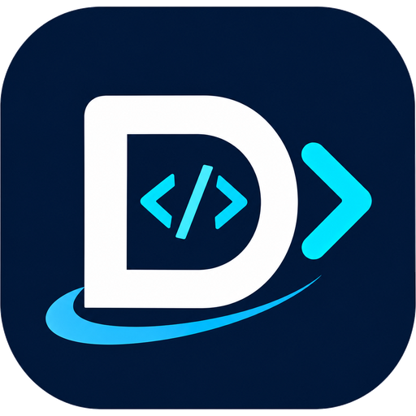

# Codes



**Codes** is a self-hosted Pastebin powered by Git. All snippets are stored in Git repositories, making them easy to manage, share, version, and access.

## Features

- Create and share code snippets.
- Git-powered storage and version history.
- Public and private snippets.
- Syntax highlighting for multiple programming languages.
- Markdown rendering.
- User authentication and access management.
- SSH and HTTP Git access.
- Self-hosted deployment and data ownership.

## Links

- [Home Page](https://codes.devemm.rw)
- [Documentation](https://codes.devemm.rw/docs)
- [Source Code](https://github.com/devemmm/codes)
- [Releases](https://github.com/devemmm/codes/releases)
- [Docker Images](https://github.com/devemmm/codes/pkgs/container/codes)

## Installation

### Docker

Pull the latest Codes image:

```bash
docker pull ghcr.io/devemmm/codes:latest
```

Run Codes:

```bash
docker run -d \
  --name codes \
  -p 6157:6157 \
  -p 2222:2222 \
  -v "$HOME/.codes:/opengist" \
  ghcr.io/devemmm/codes:latest
```

Codes will be available at:

```text
http://localhost:6157
```

For an existing OpenGist deployment, keep mounting its current host data
directory to `/opengist`. Codes retains that container path and the historical
configuration names so existing data and configuration continue to work.

### Docker Compose

Create a `docker-compose.yml` file:

```yaml
services:
  codes:
    image: ghcr.io/devemmm/codes:latest
    container_name: codes
    restart: unless-stopped
    ports:
      - "6157:6157"
      - "2222:2222"
    volumes:
      - "${HOME}/.codes:/opengist"
```

Start the application:

```bash
docker compose up -d
```

### Binary Installation

Download the appropriate binary for your operating system and architecture from the [Codes Releases](https://github.com/devemmm/codes/releases) page.

Extract the archive, make the binary executable, and run it:

```bash
chmod +x codes
./codes
```

## Development

### Requirements

- Go
- Node.js and npm
- Git

Clone the repository:

```bash
git clone https://github.com/devemmm/codes.git
cd codes
```

Install frontend dependencies:

```bash
npm ci
```

Build frontend assets:

```bash
npm run build
```

Run the application:

```bash
go run .
```

Run tests:

```bash
go test ./...
```

## Docker Image

Codes Docker images are published through GitHub Container Registry:

```text
ghcr.io/devemmm/codes
```

Available release tags include:

- `latest`
- Major version
- Major and minor version
- Full version

## Kubernetes Deployment

Codes provides a Helm chart for Kubernetes deployments.

Add the Codes Helm repository:

```bash
helm repo add codes https://codes.devemm.rw
helm repo update
```

Install Codes:

```bash
helm install opengist codes/codes
```

The chart retains the historical `opengist` release and Kubernetes resource names
to support in-place upgrades and preserve existing persistent volume claims. Use
the same release name as your existing installation when upgrading.

The Helm chart supports configurable persistence, PostgreSQL, Meilisearch, ingress, metrics, and other deployment settings.

See the [Helm chart documentation](https://github.com/devemmm/codes/tree/codes/helm/codes) for configuration details.

## Configuration

Codes supports configuration through its configuration file and environment variables.

Refer to the [configuration documentation](https://codes.devemm.rw/docs/configuration/configure) and the example configuration included in this repository before deploying to production.

## License

Codes is distributed under the [GNU Affero General Public License v3.0 (AGPL-3.0)](LICENSE).
