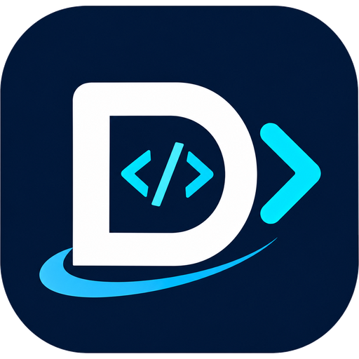

# Codes

Codes is a **self-hosted pastebin powered by Git**. All snippets are stored in Git repositories and can be read or modified using standard Git commands or the web interface.

It is similar to [GitHub Gist](https://gist.github.com/), but open-source and self-hostable.

Written in [Go](https://go.dev), Codes aims to be fast and easy to deploy.

## Features

- Create public, unlisted, or private snippets
- [Initialize](usage/init-via-git.md), clone, pull, and push snippets **via Git** over HTTP or SSH
- Syntax highlighting, Markdown, and CSV support
- Search code in snippets; browse users' snippets, likes, and forks
- Add topics to snippets
- Embed snippets in other websites
- Revision history
- Like and fork snippets
- Editor with indentation settings and drag-and-drop file support
- Download raw files or snippets as ZIP archives
- Retrieve snippet data and metadata via a JSON API
- OAuth2 login with GitHub, GitLab, Gitea, and OpenID Connect
- Avatars via Gravatar or OAuth2 providers
- Light and dark modes
- Responsive user interface
- Enable or disable user signups
- Restrict or allow snippet visibility for anonymous users
- Admin panel:
  - Delete users and snippets
  - Clean the database and filesystem by synchronizing snippets
  - Run `git gc` for all repositories
- SQLite, PostgreSQL, and MySQL database support
- Logging
- Docker support

## System requirements

[Git](https://git-scm.com/download) is required to run Codes, as Git is at the core of the application.

Version **2.28** or later is recommended. Codes has not been tested with older Git versions, and some features may not work correctly.

The [OpenSSH](https://www.openssh.com/) suite is required if you wish to use Git over SSH.

## Components

- Backend web framework: [Echo](https://echo.labstack.com/)
- ORM: [GORM](https://gorm.io/)
- Frontend libraries:
  - [Tailwind CSS](https://tailwindcss.com/)
  - [CodeMirror](https://codemirror.net/)
  - [Day.js](https://day.js.org/)
  - [And others](https://github.com/devemmm/codes/blob/codes/package.json)
